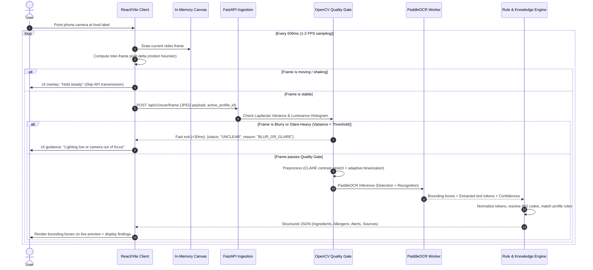
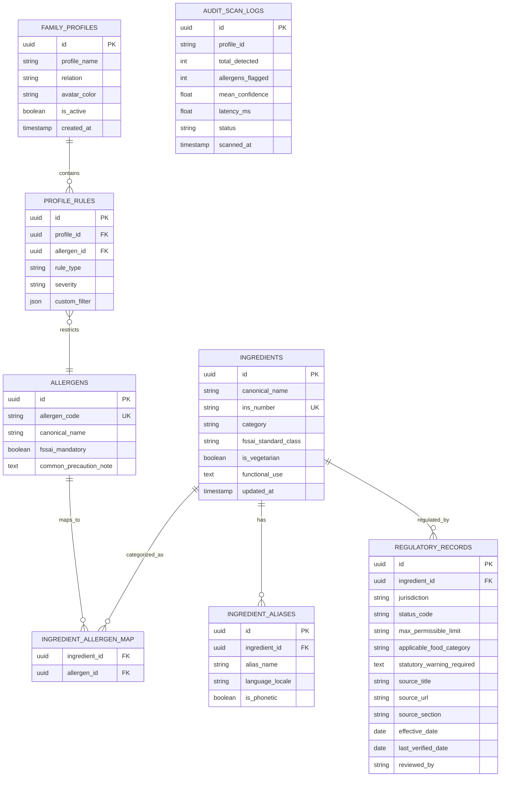

# Nirikshan AI — Architectural Blueprint & Implementation Plan
**Document Version:** 1.0.0  
**Context:** India-First Food Label Analysis Web Application  
**Reference Document:** [PRD.md](file:///d:/Nirikshan_AI/PRD.md)  
**Status:** Draft Architecture Specification for Academic & Engineering Review  
**Notice:** All performance targets and regulatory citations are proposed development goals and reference examples. They must be treated as unverified until rigorously tested on the target hardware and cross-referenced against official gazette notifications.

---

## 1. Executive Architecture Summary

Nirikshan AI is designed as an India-first food label analysis web application. It addresses common consumer pain points around packaged food products: cryptic INS/additive numbers, declared allergens, hidden sugars, palm oils, and sodium declarations under applicable Food Safety and Standards Authority of India (FSSAI) frameworks.

### Core Architectural Principles
1. **Live Camera Scanning without Button Press (Zero-Click Flow):** Video frames are sampled and pre-filtered in the browser and backend, allowing continuous analysis without requiring manual photo capture.
2. **Strict Deterministic Rules over Generative Guesswork:** Extraction, normalization, and profile/regulatory matching are strictly code-driven against curated datasets. No generative model is permitted to invent or decide legal or safety status.
3. **Traceability and Explicit Uncertainty:** Every alert must cite an official source, jurisdiction, and verification date. If text is unreadable or evidence is absent, the system explicitly returns `UNCLEAR` or `UNVERIFIED` rather than asserting safety.
4. **Zero-Retention Privacy:** Raw camera frames are processed in-memory and discarded immediately; no user label photos or biometric/facial imagery are persisted to disk by default.

```
+------------------------------------------------------------------------------------------------+
|                                    Nirikshan AI Web Client                                     |
|  - React 18+ / TypeScript / Vite / TailwindCSS / Lucide Icons                                  |
|  - HTML5 MediaDevices (getUserMedia) 1080p stream                                              |
|  - Client-Side Stability Gate (HTML5 Canvas diff / requestVideoFrameCallback)                  |
|  - Sub-second Frame Sampler (1-2 FPS throttled, avoids server flooding)                        |
|  - Real-time UI Bounding Box Overlays & Audio/Haptic Guidance                                   |
+------------------------------------------------------------------------------------------------+
                                           │  HTTPS POST /api/v1/scan/frame
                                           ▼
+------------------------------------------------------------------------------------------------+
|                                  FastAPI Backend Ingestion                                     |
|  - Async Request Ingestion & Rate Limiting                                                     |
|  - OpenCV Preprocessing: Blur detection (Laplacian variance), contrast stretch (CLAHE), deskew  |
|  - Quality Guard: If score < Threshold -> Return immediate "UNCLEAR: Hold Steady" (Fast Exit) |
+------------------------------------------------------------------------------------------------+
                                           │  High Quality Frame
                                           ▼
+------------------------------------------------------------------------------------------------+
|                                 PaddleOCR Detection & Recognition                              |
|  - PaddleOCR DBNet Text Detector -> Angle Classifier -> SVTR/CRNN Recognizer                   |
|  - Text bounding boxes + polygon coordinates + character confidence scores                     |
+------------------------------------------------------------------------------------------------+
                                           │
                                           ▼
+------------------------------------------------------------------------------------------------+
|                        Text Normalization & Domain Extraction Engine                           |
|  - Regex / Heuristic Tokenizer for Indian label patterns ("Ingredients:", "Contains:", "INS") |
|  - Canonical name resolution, alias mapping, INS/E-code expansion (e.g. INS 621 -> MSG)       |
+------------------------------------------------------------------------------------------------+
                                           │
                                           ▼
+------------------------------------------------------------------------------------------------+
|                        Deterministic Rule Engine & Curated Knowledge Base                      |
|  - Curated FSSAI Regulatory Reference Data (verified via official gazette notifications)      |
|  - Mandatory Allergen Checks + Watchlists (Palm Oil, Added Sugars, Sodium thresholds)         |
|  - Family Dietary Profile Matcher (Cross-check against active profile rules)                   |
|  - Unverified Fallback: Explicit status when evidence is missing or confidence is low          |
+------------------------------------------------------------------------------------------------+
                                           │
                                           ▼
+------------------------------------------------------------------------------------------------+
|                           Evidence-Backed Response Payload Builder                             |
|  - Strict schema: Status code, ingredient token, source citation, jurisdiction (IN), date      |
|  - No blanket "Safe to Eat" claims; objective, granular, source-verifiable findings            |
+------------------------------------------------------------------------------------------------+
```

---

## 2. System Architecture & End-to-End Data Flow

### 2.1 Live Camera Scanning Pipeline (Zero-Click Flow)

Continuously streaming full-resolution video to a backend server at 30 FPS can saturate network bandwidth and overwhelm OCR inference workers. Nirikshan AI uses a **Client-Side Stability Filter + Server-Side Fast-Exit Quality Gate**:



### 2.2 Processing & Safety Stages

1. **Client Frame Sampler**:
   - Uses `requestVideoFrameCallback` (with `setInterval` fallback) at an interval of 500ms–1000ms.
   - Evaluates a 2-frame canvas luminance delta to detect user camera motion. If the camera is rapidly panning or shaking, frame dispatch is skipped locally to save battery and network bandwidth.
2. **OpenCV Quality Gate (Fast-Exit)**:
   - **Blur Detection**: Calculates the variance of the Laplacian operator ($\sigma^2 < 100 \implies \text{Blurry}$).
   - **Glare & Exposure Check**: Inspects brightness histogram to detect blown-out specular highlights from plastic food packaging.
   - **Fast Exit Response**: If quality criteria fail, immediately returns an HTTP 200 payload with `status: "UNCLEAR"` and corrective guidance without invoking PaddleOCR.
3. **PaddleOCR Engine**:
   - Uses PaddleOCR detection (DBNet) and recognition models (SVTR/CRNN) loaded as a singleton service.
   - Extracts character sequences, polygon coordinates, and per-token confidence scores.
4. **Text Normalization**:
   - Tokenizes ingredient strings using standard packaging delimiters (commas, parentheses, semicolons).
   - Normalizes known spelling variations, bilingual fragments, and additive code patterns (e.g., `"INS 621"`, `"E621"`, `"621"` $\to$ `"Monosodium Glutamate"`).
5. **Deterministic Rule Engine & Traceable Verification**:
   - Compares normalized ingredients against the user's active family profile (e.g., Peanut allergy, Jain dietary preference, Palm oil avoidance).
   - Looks up official FSSAI regulatory status from curated tables.
   - **Fallback on Missing Data**: If an ingredient is not documented in the database, it is classified as `UNVERIFIED_ENTRY`. The system does not assume an ingredient is harmless simply because it is absent from the database.

---

## 3. Project Directory & Monorepo Structure

```
Nirikshan_AI/
├── .github/
│   └── workflows/
│       ├── test-backend.yml
│       └── test-frontend.yml
├── data/
│   ├── curated/
│   │   ├── fssai_additives_ins.json       # Curated FSSAI Food Additives & INS codes
│   │   ├── fssai_mandatory_allergens.json # Mandatory allergens specified under FSSAI regulations
│   │   ├── ingredient_aliases.json        # Verified synonyms (e.g., Maida -> Refined Wheat Flour)
│   │   └── watchlist_rules.json           # Declarations for palm oil, high sodium, added sugars
│   └── evaluation_dataset/
│       ├── images/                        # ~100 Indian packaged food label test images
│       │   ├── clear/
│       │   ├── low_light/
│       │   ├── blurred/
│       │   └── angled/
│       ├── ground_truth.json              # Manually annotated ingredient lists & allergen labels
│       └── baseline_results/              # Evaluation output: PaddleOCR vs Gemini baseline
├── backend/
│   ├── app/
│   │   ├── __init__.py
│   │   ├── main.py                        # FastAPI entrypoint & CORS configuration
│   │   ├── core/
│   │   │   ├── config.py                  # Environment settings & thresholds
│   │   │   └── logging.py                 # Structured audit logging (zero raw-frame persistence)
│   │   ├── api/
│   │   │   ├── v1/
│   │   │   │   ├── router.py              # API v1 route aggregator
│   │   │   │   ├── scan.py                # Frame scan & manual verification endpoints
│   │   │   │   ├── profiles.py            # Family dietary profile endpoints
│   │   │   │   ├── ingredients.py         # Search & query canonical ingredient database
│   │   │   │   └── regulatory.py          # Regulatory citation details
│   │   ├── models/
│   │   │   ├── domain.py                  # SQLAlchemy ORM models
│   │   │   └── schemas.py                 # Pydantic v2 schemas for requests & responses
│   │   ├── services/
│   │   │   ├── cv_preprocessor.py         # OpenCV blur, glare, contrast & deskew filters
│   │   │   ├── ocr_engine.py              # PaddleOCR model loader & inference runner
│   │   │   ├── normalizer.py              # INS code parser, alias matcher, regex cleaner
│   │   │   ├── rule_engine.py             # Deterministic allergen & dietary profile matcher
│   │   │   └── evidence_service.py        # Regulatory source citation & status resolver
│   │   ├── db/
│   │   │   ├── session.py                 # Async SQLAlchemy engine & session maker
│   │   │   ├── seed.py                    # Seeder script to load curated JSONs into SQLite/Postgres
│   │   │   └── migrations/                # Alembic migration revisions
│   │   └── tests/
│   │       ├── test_cv_preprocessor.py
│   │       ├── test_normalizer.py
│   │       ├── test_rule_engine.py
│   │       └── test_api_scan.py
│   ├── requirements.txt
│   ├── Dockerfile
│   └── README.md
├── frontend/
│   ├── public/
│   │   ├── favicon.ico
│   │   └── sound/                         # Optional subtle haptic/audio cues on scan
│   ├── src/
│   │   ├── assets/
│   │   ├── components/
│   │   │   ├── camera/
│   │   │   │   ├── CameraStream.tsx       # Live getUserMedia video element
│   │   │   │   ├── TargetFrame.tsx        # Alignment guide & target reticle
│   │   │   │   ├── BoundingBoxCanvas.tsx  # Dynamic overlay for detected label regions
│   │   │   │   └── StabilityIndicator.tsx # Visual feedback ("Hold Still", "Ready")
│   │   │   ├── alerts/
│   │   │   │   ├── AllergenBadge.tsx      # High-visibility allergen indicators
│   │   │   │   ├── RegulatoryCard.tsx     # Source link, jurisdiction, update date
│   │   │   │   ├── UncertaintyDrawer.tsx  # Highlights unreadable/unverified tokens
│   │   │   │   └── ManualEditModal.tsx    # Tap-to-edit fallback for low-confidence text
│   │   │   ├── profile/
│   │   │   │   ├── ProfileSelector.tsx    # Family profile switch (Mom, Child, Self)
│   │   │   │   └── ProfileEditor.tsx      # Preferences (Jain, Vegan, Gluten, Nut allergy)
│   │   │   └── layout/
│   │   │       ├── Header.tsx
│   │   │       ├── BottomNav.tsx
│   │   │       └── DisclaimerBanner.tsx   # Informational banner (No medical claims)
│   │   ├── hooks/
│   │   │   ├── useCamera.ts               # Camera permission & stream lifecycle
│   │   │   ├── useFrameSampler.ts         # Throttled frame capture & motion heuristic
│   │   │   └── useProfiles.ts             # State management for family profiles
│   │   ├── services/
│   │   │   ├── api.ts                     # Axios / fetch client with type-safe contracts
│   │   │   └── storage.ts                 # LocalStorage cache for profile preferences
│   │   ├── types/
│   │   │   ├── scan.ts                    # Scan request/response TypeScript interfaces
│   │   │   └── profile.ts                 # Profile & allergen TypeScript models
│   │   ├── styles/
│   │   │   └── index.css                  # Modern CSS & token utilities
│   │   ├── App.tsx
│   │   └── main.tsx
│   ├── package.json
│   ├── tsconfig.json
│   ├── vite.config.ts
│   └── README.md
├── scripts/
│   ├── run_baseline_evaluation.py         # Evaluation benchmark harness (Nirikshan vs Gemini)
│   └── seed_database.py                   # Data ingestion CLI
├── ARCHITECTURE.md                        # This document
└── PRD.md                                 # Product Requirements Document
```

---

## 4. API Endpoints Specification

FastAPI manages the REST API endpoints under `/api/v1`.

### 4.1 Endpoints Overview

| Method | Endpoint | Description | Expected Target |
| :--- | :--- | :--- | :--- |
| `POST` | `/api/v1/scan/frame` | **Primary live scan**: Ingests sampled frame, runs CV filter, PaddleOCR, and rule matching | $< 500\text{ ms}$ (tested on standard server) |
| `POST` | `/api/v1/scan/verify-manual` | **Manual correction fallback**: User confirms or corrects a low-confidence token string | $< 50\text{ ms}$ |
| `GET` | `/api/v1/profiles` | List all configured family profiles | $< 50\text{ ms}$ |
| `POST` | `/api/v1/profiles` | Create or update a dietary/allergen family profile | $< 100\text{ ms}$ |
| `DELETE` | `/api/v1/profiles/{id}` | Delete family profile (with immediate local purge) | $< 50\text{ ms}$ |
| `GET` | `/api/v1/ingredients/search` | Search canonical ingredient database and INS codes | $< 50\text{ ms}$ |
| `GET` | `/api/v1/regulatory/fssai/{code}` | Retrieve full regulatory citation, source URL, effective date | $< 30\text{ ms}$ |
| `GET` | `/api/v1/health` | Health check (PaddleOCR readiness, database connectivity) | $< 10\text{ ms}$ |

---

### 4.2 Key Payloads

#### Request: `POST /api/v1/scan/frame`
```json
{
  "frame_base64": "data:image/jpeg;base64,/9j/4AAQSkZJRg...",
  "active_profile_id": "prof_child_001",
  "client_timestamp": "2026-10-27T17:47:04.000Z",
  "client_motion_score": 0.04
}
```

#### Response: Fast Exit on Low Quality
```json
{
  "status": "UNCLEAR",
  "quality_score": 0.32,
  "guidance": "HOLD_STEADY",
  "message": "Image is blurry or glare detected. Reposition camera on the ingredient list.",
  "bounding_boxes": [],
  "findings": []
}
```

#### Response: Successful Scan with Traceable Evidence
```json
{
  "status": "ANALYZED",
  "quality_score": 0.89,
  "scan_summary": {
    "total_ingredients_detected": 14,
    "allergens_flagged": 2,
    "dietary_violations": 1,
    "unverified_count": 1
  },
  "raw_extracted_text": "Ingredients: Refined Wheat Flour (Maida), Palm Oil, Sugar, Milk Solids, INS 621, Permitted Flavours.",
  "items": [
    {
      "token_id": "tok_1",
      "raw_text": "Refined Wheat Flour (Maida)",
      "canonical_name": "Wheat Flour",
      "ins_code": null,
      "ocr_confidence": 0.96,
      "bounding_box": [[42, 110], [210, 110], [210, 135], [42, 135]],
      "status_category": "LABEL_DECLARED_ALLERGEN",
      "profile_match": {
        "matched": true,
        "rule_name": "Gluten / Wheat Allergy",
        "severity": "CRITICAL",
        "for_profile": "Aarav (Child)"
      },
      "evidence": {
        "source_name": "FSSAI Food Safety and Standards (Labelling and Display) Regulations",
        "source_section": "Mandatory Allergen Declarations",
        "source_url": "https://www.fssai.gov.in/food-law/regulations/amendments/labelling-display",
        "jurisdiction": "India",
        "last_verified_date": "2026-03-24"
      }
    },
    {
      "token_id": "tok_2",
      "raw_text": "Palm Oil",
      "canonical_name": "Palm Oil",
      "ins_code": null,
      "ocr_confidence": 0.94,
      "bounding_box": [[215, 110], [305, 110], [305, 135], [215, 135]],
      "status_category": "DIETARY_WATCH",
      "profile_match": {
        "matched": true,
        "rule_name": "Avoid Palm Oil / Saturated Fats",
        "severity": "WARNING",
        "for_profile": "Dad (Heart Health)"
      },
      "evidence": {
        "source_name": "FSSAI Mandatory Vegetable Oil Identification Regulations",
        "source_section": "Specific Name Declaration Requirement",
        "source_url": "https://www.fssai.gov.in/standards/product-standards",
        "jurisdiction": "India",
        "last_verified_date": "2026-01-15"
      }
    },
    {
      "token_id": "tok_5",
      "raw_text": "INS 621",
      "canonical_name": "Monosodium Glutamate (MSG)",
      "ins_code": "621",
      "ocr_confidence": 0.91,
      "bounding_box": [[310, 140], [380, 140], [380, 165], [310, 165]],
      "status_category": "REGULATED_ADDITIVE",
      "profile_match": {
        "matched": false,
        "rule_name": null,
        "severity": "INFO",
        "for_profile": null
      },
      "evidence": {
        "source_name": "FSSAI Food Product Standards and Food Additives Regulations",
        "source_section": "Flavour Enhancers Permitted in Specified Food Categories",
        "source_url": "https://www.fssai.gov.in/standards/product-standards",
        "jurisdiction": "India",
        "last_verified_date": "2026-03-24"
      }
    },
    {
      "token_id": "tok_6",
      "raw_text": "Hydrolyzed Veg Protein X4",
      "canonical_name": null,
      "ins_code": null,
      "ocr_confidence": 0.58,
      "bounding_box": [[390, 140], [520, 140], [520, 165], [390, 165]],
      "status_category": "UNVERIFIED_UNCLEAR",
      "profile_match": {
        "matched": false,
        "rule_name": null,
        "severity": "NEEDS_REVIEW",
        "for_profile": null
      },
      "evidence": {
        "source_name": "Nirikshan Knowledge Base",
        "source_section": "Unmatched Entry / Low OCR Confidence (< 0.65)",
        "source_url": null,
        "jurisdiction": "India",
        "last_verified_date": null
      }
    }
  ]
}
```

---

## 5. Database Schema & Data Modeling

The relational model is designed for PostgreSQL in production and SQLite for local development.



### 5.1 Privacy & Data Protection Safeguards
- **Zero Raw Frame Persistence:** `AUDIT_SCAN_LOGS` explicitly avoids saving uploaded images, user faces, or ambient backgrounds.
- **Minimal Telemetry:** Only anonymized timing, total token counts, and error frequency are logged for system performance debugging.

---

## 6. Status Vocabulary & Safety Design (Zero-Hallucination)

Nirikshan AI strictly prohibits definitive clinical claims or blanket safe verdicts. The UI uses an explicit 6-tier status classification:

| Status Code | Trigger & System Behavior | Visual & UX Presentation |
| :--- | :--- | :--- |
| **`LABEL_DECLARED_ALLERGEN`** | Direct match with declared allergens under FSSAI schedule (e.g. Peanut, Milk, Wheat, Soy). | High-contrast alert badge; device vibration cue; highlights exact token on camera overlay. |
| **`PROFILE_DIET_ALERT`** | Matches user's configured dietary restriction (e.g., Jain [root vegetables], Palm Oil, High Sodium). | High-contrast amber badge indicating for whom the alert was triggered (e.g., "Dad's Watchlist"). |
| **`REGULATED_CONDITION`** | Additive permitted under specific condition, category limit, or requiring a statutory warning. | Blue informational card with direct link to official FSSAI gazette or regulations page. |
| **`UNVERIFIED_ENTRY`** | Ingredient recognized by OCR but not found in the verified database. | Grey dashed indicator stating *"Unverified in official database — verify independently"*. |
| **`UNCLEAR_NEEDS_REVIEW`** | OCR confidence $< 0.65$ or partially obscured packaging text. | Yellow striped bounding box on screen. Tapping opens a manual 1-tap correction modal. |
| **`PERMITTED_STANDARD`** | Common recognized food component (e.g., Salt, Water, Wheat Flour) without flagged conditions. | Neutral subtle tag; no exaggerated or clinical "Healthy / Safe" claim. |

---

## 7. Phased Implementation Plan

### Phase 1: Curated Knowledge Base & Seed Data (Week 1)
- [ ] Initialize repository structure (`frontend/`, `backend/`, `data/`).
- [ ] Set up Python environment with FastAPI, SQLAlchemy, and SQLite.
- [ ] Ingest initial seed data into `data/curated/`:
  - 8 FSSAI Mandatory Allergens.
  - Initial set of verified Indian Food Additives & INS codes.
  - Verified ingredient synonyms and aliases.
- [ ] Implement deterministic normalizer and rule engine unit tests.

### Phase 2: OpenCV Quality Gate & PaddleOCR Pipeline (Week 2)
- [ ] Implement `cv_preprocessor.py` for Laplacian blur detection and CLAHE contrast enhancement.
- [ ] Integrate PaddleOCR singleton service with ONNX/CPU acceleration.
- [ ] Implement fast-exit response: return `UNCLEAR` for low-quality frames within 30ms before invoking OCR.
- [ ] Implement `POST /api/v1/scan/frame` endpoint and integration tests.

### Phase 3: Mobile-First React Frontend & Zero-Click Scanner (Week 3)
- [ ] Scaffold React + TypeScript + Vite web application with Tailwind CSS.
- [ ] Implement `useCamera` hook supporting rear-camera selection and stream lifecycle.
- [ ] Implement `useFrameSampler` with canvas motion-delta detection to throttle frame dispatches.
- [ ] Build `BoundingBoxCanvas` overlay showing real-time feedback directly on the camera preview.
- [ ] Add visual and haptic feedback (`navigator.vibrate`) when alerts are triggered.

### Phase 4: Family Dietary Profiles & Evidence View UI (Week 4)
- [ ] Implement LocalStorage-backed Family Profile management (Self, Child, Parent).
- [ ] Support dietary presets: Jain, Vegetarian, Vegan, Gluten-Free, Nut Allergy, Palm Oil Free.
- [ ] Build the Evidence Drawer component displaying official source citations, jurisdiction, and dates.
- [ ] Implement tap-to-edit modal allowing users to manually correct low-confidence OCR text.

### Phase 5: Benchmark Evaluation Harness (Week 5)
- [ ] Curate an evaluation dataset of ~100 Indian packaged food label photos across 5 product categories.
- [ ] Create annotated ground truth for text tokens, allergens, and additive codes.
- [ ] Build benchmark script `scripts/run_baseline_evaluation.py` comparing Nirikshan AI with a Gemini-only vision baseline.
- [ ] Measure exact match, allergen recall, abstention rate on degraded images, and response latency.

---

## 8. Evaluation & Testing Plan

### 8.1 The 100-Label Indian Food Benchmark Dataset
Labels will represent real-world Indian supermarket conditions:
- **Clean / Flat (30 images):** Cereal boxes, biscuit cartons.
- **Wrinkled / Flexible Packaging (25 images):** Chips packets, namkeen pouches.
- **Cylindrical / Curved (20 images):** Beverage cans, sauce bottles.
- **Degraded / Challenging (25 images):** Low light, store glare, motion blur, angled text.

### 8.2 Proposed Development Targets (To Be Evaluated)
*Note: The following metrics are development goals from the PRD and must be verified empirically:*

| Dimension | Target Goal | Verification Method |
| :--- | :--- | :--- |
| **Ingredient Token Accuracy** | $\ge 90\%$ Exact Match | Token F1-score against manual annotations |
| **Declared Allergen Detection** | $\ge 90\%$ Recall | Evaluated on annotated allergen statements |
| **Abstention Accuracy** | $\ge 90\%$ Correct Abstention | Evaluated on intentionally blurry/glare test set |
| **Evidence Coverage** | $100\%$ Sourced (or Unverified) | Automated check that every alert has a source citation |
| **End-to-End Response Time** | Target $< 500\text{ ms}$ on server | Measured from stable frame dispatch to response |

---

## 9. Dependencies & Setup Commands

### 9.1 Backend Setup (Python 3.10+)

```bash
# 1. Create and activate virtual environment
cd d:/Nirikshan_AI
python -m venv venv
.\venv\Scripts\activate   # On Windows (use `source venv/bin/activate` on Linux/macOS)

# 2. Install dependencies
pip install --upgrade pip
pip install fastapi uvicorn[standard] python-multipart pydantic requests
pip install opencv-python-headless numpy
pip install paddlepaddle paddleocr --upgrade
pip install sqlalchemy aiosqlite pytest httpx

# 3. Seed initial curated reference data
python backend/app/db/seed.py

# 4. Start backend development server
uvicorn backend.app.main:app --host 0.0.0.0 --port 8000 --reload
```

#### Backend `requirements.txt`
```txt
fastapi>=0.110.0
uvicorn[standard]>=0.28.0
python-multipart>=0.0.9
pydantic>=2.6.4
opencv-python-headless>=4.9.0.86
numpy>=1.26.4
paddlepaddle>=2.6.0
paddleocr>=2.8.0
sqlalchemy>=2.0.28
aiosqlite>=0.20.0
pytest>=8.1.1
httpx>=0.27.0
python-dotenv>=1.0.1
```

---

### 9.2 Frontend Setup (React + TypeScript + Vite)

```bash
# 1. Initialize Vite application in frontend folder
cd d:/Nirikshan_AI
npm create vite@latest frontend -- --template react-ts

# 2. Enter and install core dependencies
cd frontend
npm install
npm install lucide-react clsx tailwindmerge axios

# 3. Setup TailwindCSS for responsive styling
npm install -D tailwindcss postcss autoprefixer
npx tailwindcss init -p

# 4. Start frontend live server
npm run dev
```

---

## 10. Architectural Assumptions, Key Risks & Mitigations

| # | Domain | Identified Risk | Impact | Architectural Mitigation |
| :--- | :--- | :--- | :--- | :--- |
| **1** | **Camera / Bandwidth** | Continuous video frame dispatch from mobile browsers can drain battery and overload network. | High latency, network congestion | **Client-Side Motion Gate:** Browser checks inter-frame pixel differences. Frames are only sent when the camera is steady, throttled to 1-2 FPS. |
| **2** | **OCR Ambiguity** | PaddleOCR may misread complex fonts or Hindi/English hybrid labels (e.g., `"Maida"` misread as `"Malda"`). | Missed allergen or false warning | **Fuzzy Alias Resolution + Manual Override:** Match against canonical dictionaries with explicit `UNCLEAR` state and 1-tap manual edit modal. |
| **3** | **Regulatory Verification** | FSSAI regulations undergo periodic amendments; unofficial or outdated data could mislead users. | Inaccurate regulatory claims | **Strict Sourcing & Unverified Fallback:** Only verified official gazette entries are included; unverified ingredients explicitly show `UNVERIFIED_STATUS`. |
| **4** | **Medical Liability** | A user might assume an unflagged product is completely safe for severe clinical allergies. | Unsafe health decisions | **Prominent Educational Disclaimers:** Visible notice that Nirikshan AI inspects printed label text only and cannot guarantee absence of undeclared factory contamination. |
| **5** | **Privacy & Security** | Inadvertent capture and storage of camera frames showing personal spaces or faces. | Privacy risk (DPDP Act 2023) | **Ephemeral Processing:** Frames are processed in volatile memory and immediately deallocated. Zero persistence of camera frames to disk. |

---

## 11. Next Recommended Steps

1. **Review and approve this architectural specification.**
2. **Scaffold the project directory** (`frontend/`, `backend/`, and `data/` directories).
3. **Assemble the curated seed files** in `data/curated/` before writing frontend components.
